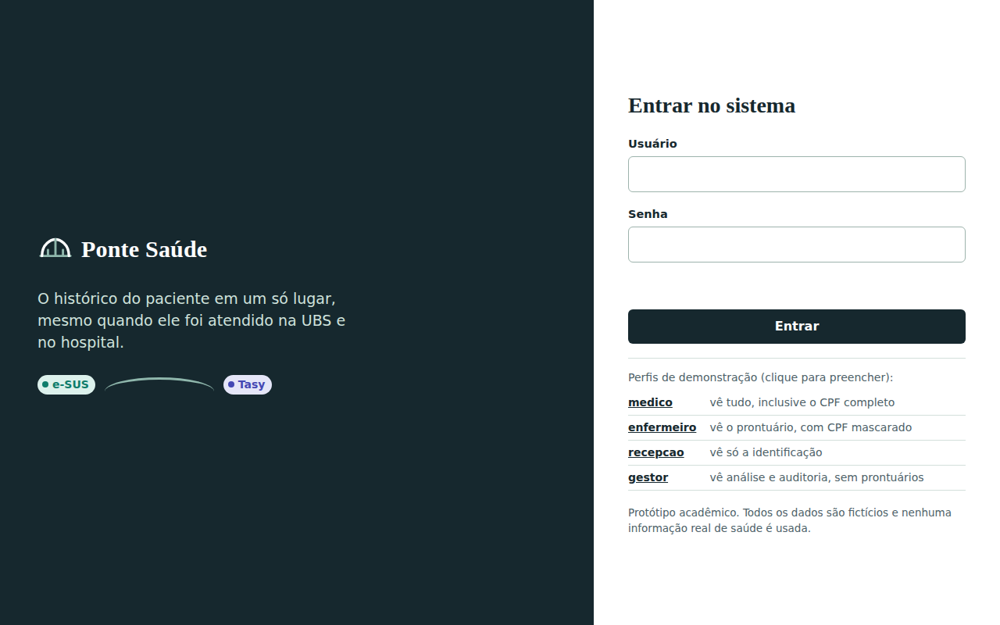
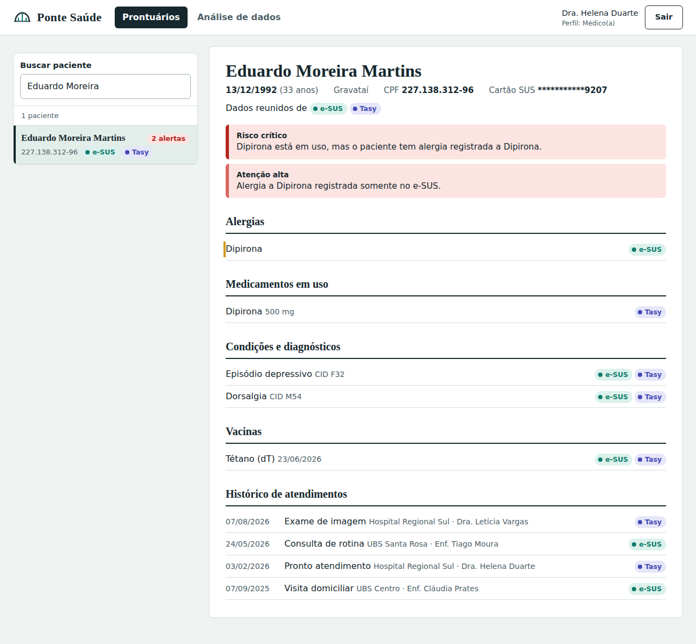
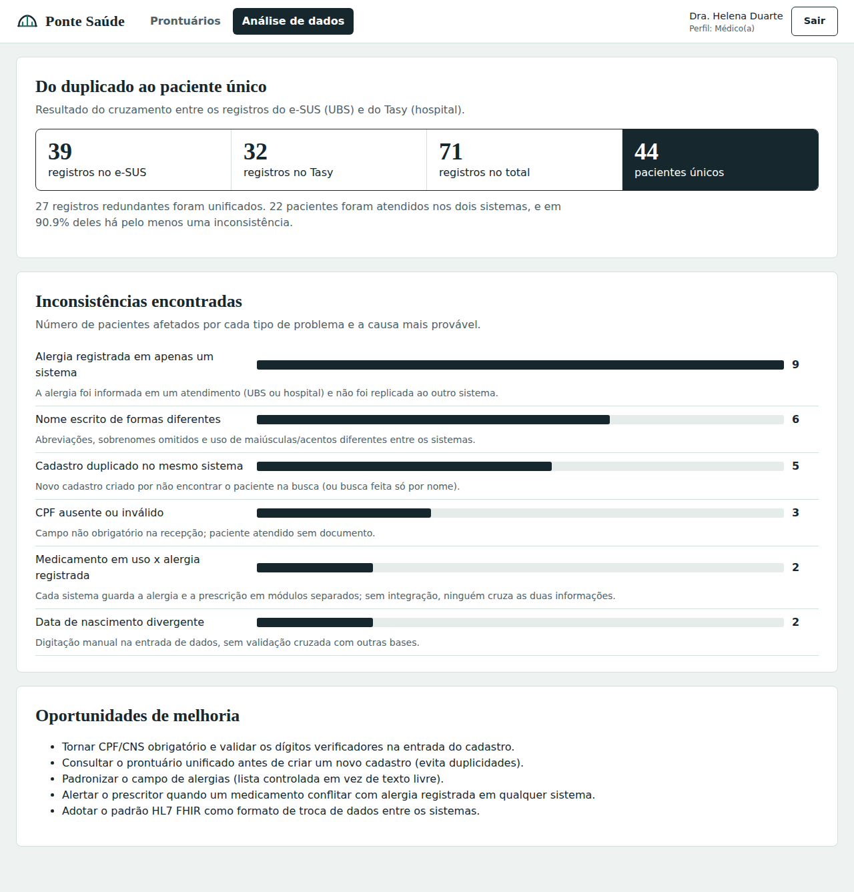

# Ponte Saúde

Prova de Conceito (PoC) de um **prontuário unificado**: um sistema que reúne, em uma única tela, os dados de um paciente que estão separados em sistemas diferentes de saúde (o **e-SUS**, usado nas UBSs, e o **Tasy**, usado em hospitais).

Projeto do Projeto Integrador 1 (curso de Análise e Desenvolvimento de Sistemas, Unilasalle).

> **Todos os dados são 100% fictícios.** Nenhuma informação real de paciente é usada, em respeito à LGPD (Lei 13.709/2018).

## Integrantes

- Karolina Maria Quintanilha de Souza
- Gilberto Elias Seghir Neto
- Arthur Finamore de Oliveira
- Bruno José de Castro Silva

## Prévia do sistema







A pasta `docs/` contém uma versão de pré-visualização que roda só no navegador (use o usuário `medico` e a senha `med123`). Para ver o sistema completo, siga a seção "Como rodar".

## O problema

As informações de saúde da população estão espalhadas em sistemas que não conversam entre si. Quando um paciente atendido na UBS chega ao hospital, o médico não vê as alergias, os medicamentos e o histórico registrados no outro sistema, e isso reduz a segurança e a precisão do atendimento.

## O que o sistema faz

1. **Simula os dois sistemas.** Gera dados fictícios com os formatos próprios do e-SUS e do Tasy, incluindo problemas propositais (CPF ausente, nome diferente, alergia registrada só em um lado, cadastro duplicado, data de nascimento divergente).
2. **Normaliza e unifica.** Coloca CPF, datas e nomes no mesmo padrão e descobre quais registros são da mesma pessoa (por CPF; se faltar, por nome + data de nascimento, sem juntar homônimos com CPF diferente).
3. **Analisa os dados.** Mede as inconsistências, aponta as causas prováveis e gera relatórios na pasta `relatorio/`.
4. **Alerta riscos clínicos.** Por exemplo: medicamento em uso no hospital para um paciente com alergia a esse medicamento registrada na UBS.
5. **Protege o acesso.** Login com senha criptografada (PBKDF2), perfis com permissões diferentes, CPF mascarado, bloqueio após tentativas erradas e auditoria de todos os acessos.
6. **Mostra tudo em um painel web** com prontuário unificado, análise de dados e auditoria.

## Como rodar

Você só precisa do **Python 3.8 ou mais novo**. Não há nada para instalar (o projeto usa apenas a biblioteca padrão).

1. Baixe o Python em https://www.python.org/downloads/ (no Windows, marque a opção **Add Python to PATH** na instalação).
2. Extraia a pasta do projeto e abra um terminal dentro dela.
3. Rode:

```bash
python ponte_saude.py
```

No Windows, se `python` não funcionar, use `py ponte_saude.py`. No Mac/Linux, use `python3 ponte_saude.py`.

O navegador abre sozinho em http://127.0.0.1:8000. Se não abrir, copie esse endereço. Para parar o sistema, use `Ctrl+C` no terminal.

### Outros comandos

| Comando | O que faz |
|---|---|
| `python ponte_saude.py preparar` | Gera novos dados fictícios e os relatórios de análise (pasta `relatorio/`) |
| `python ponte_saude.py testar` | Roda os 28 testes automatizados |
| `python ponte_saude.py servir --porta 8080` | Abre o sistema em outra porta |

## Usuários de demonstração

| Usuário | Senha | O que vê |
|---|---|---|
| `medico` | `med123` | Tudo, inclusive o CPF completo e a análise de dados |
| `enfermeiro` | `enf123` | Prontuário completo, com CPF mascarado |
| `recepcao` | `rec123` | Apenas a identificação (sem dados clínicos) |
| `gestor` | `ges123` | Análise de dados e auditoria, sem acesso aos prontuários |

## Sugestão de roteiro para demonstrar

1. Entre como `medico` e busque por **Eduardo Moreira**: o alerta crítico mostra uma Dipirona em uso por um paciente com alergia à Dipirona registrada na UBS (um risco que nenhum dos dois sistemas detectaria sozinho).
2. Abra outros pacientes com alertas e veja de qual sistema vem cada informação (marcas **e-SUS** e **Tasy**).
3. Entre como `recepcao` e abra o mesmo paciente: os dados clínicos ficam restritos.
4. Entre como `gestor`: veja a aba **Análise de dados** e a **Auditoria de acessos**, onde as tentativas negadas aparecem registradas.

## Estrutura do projeto

```
ponte_saude.py        ponto de entrada (comandos)
gerar_dados.py        gera os dados fictícios do e-SUS, do Tasy e os usuários
ponte/
  normalizacao.py     padroniza CPF, datas e nomes
  unificacao.py       lê os sistemas, agrupa registros e monta o prontuário unificado
  analise.py          mede as inconsistências e gera os relatórios
  seguranca.py        login, perfis, mascaramento (LGPD) e auditoria
  servidor.py         API web (biblioteca padrão do Python)
web/index.html        painel (interface do usuário)
tests/                testes automatizados
dados/                dados fictícios gerados
relatorio/            relatórios de análise e prints de evidência
logs/                 auditoria de acessos (criada ao usar o sistema)
```

## Referências

- HL7 International. HL7 Fast Healthcare Interoperability Resources (FHIR). https://hl7.org/fhir
- BRASIL. Lei nº 13.709, de 14 de agosto de 2018 (LGPD).
- PRESSMAN, R. S.; MAXIM, B. R. Engenharia de Software: uma abordagem profissional. 9. ed. Porto Alegre: AMGH, 2021.
- e-SUS APS: https://sisaps.saude.gov.br/sistemas/esusaps/
- Tasy: https://tasy.huhsp.org.br/sobre-o-tasy

## Limitações (prova de conceito)

- Usa dados simulados; em produção seria necessário integrar com as bases reais (idealmente via padrão HL7 FHIR) e ter autorização formal das instituições.
- O servidor embutido é para demonstração; em produção seria preciso HTTPS, banco de dados e gestão de usuários.
- A unificação por nome + data de nascimento é uma regra simples; em produção convém usar também revisão humana dos casos duvidosos.
